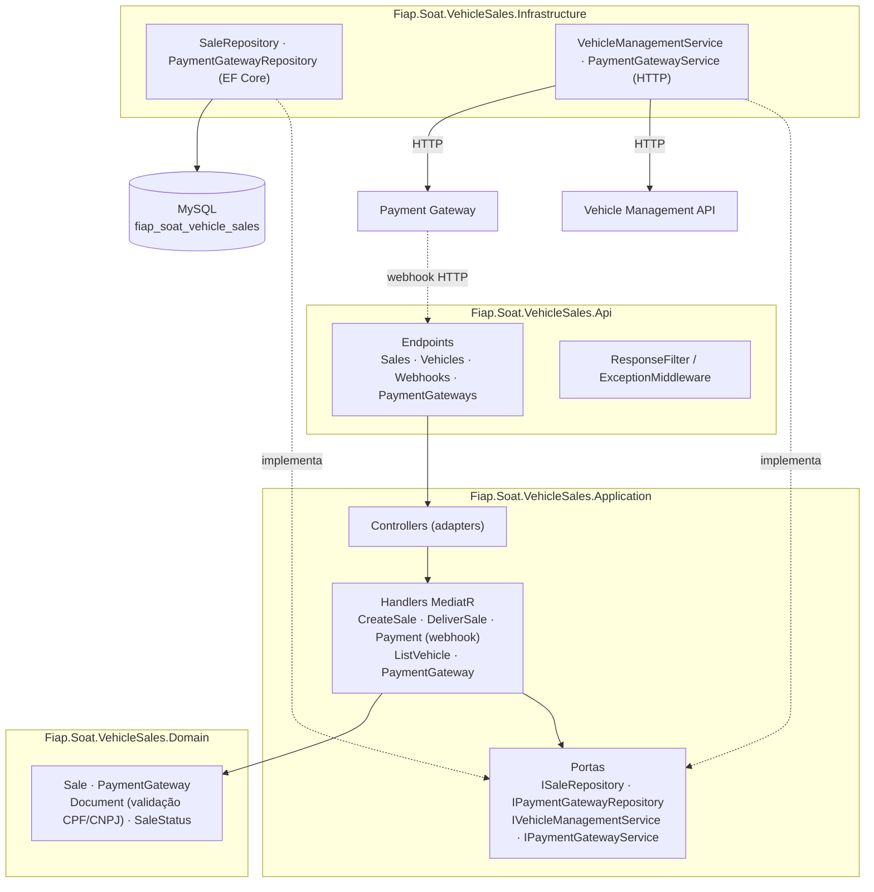
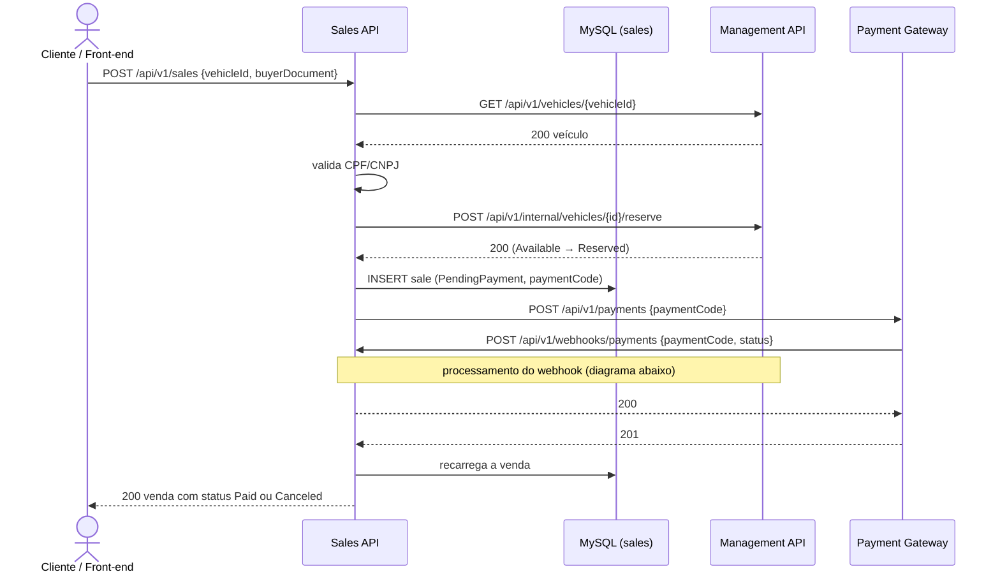
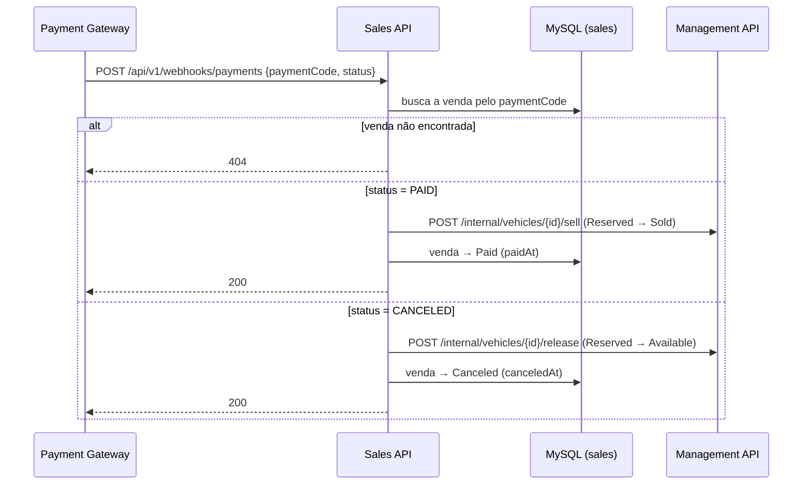
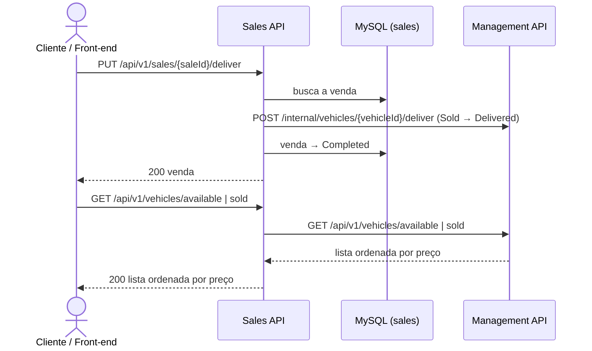
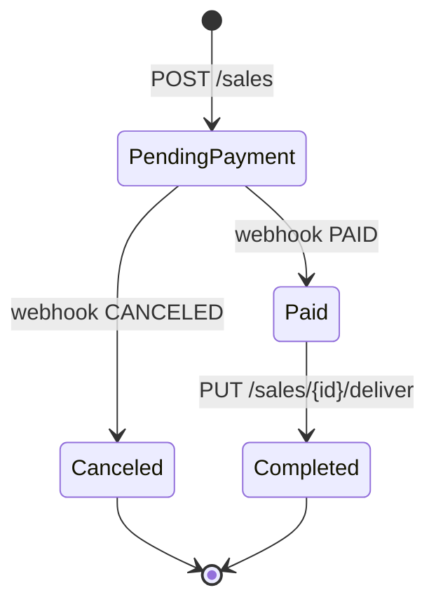
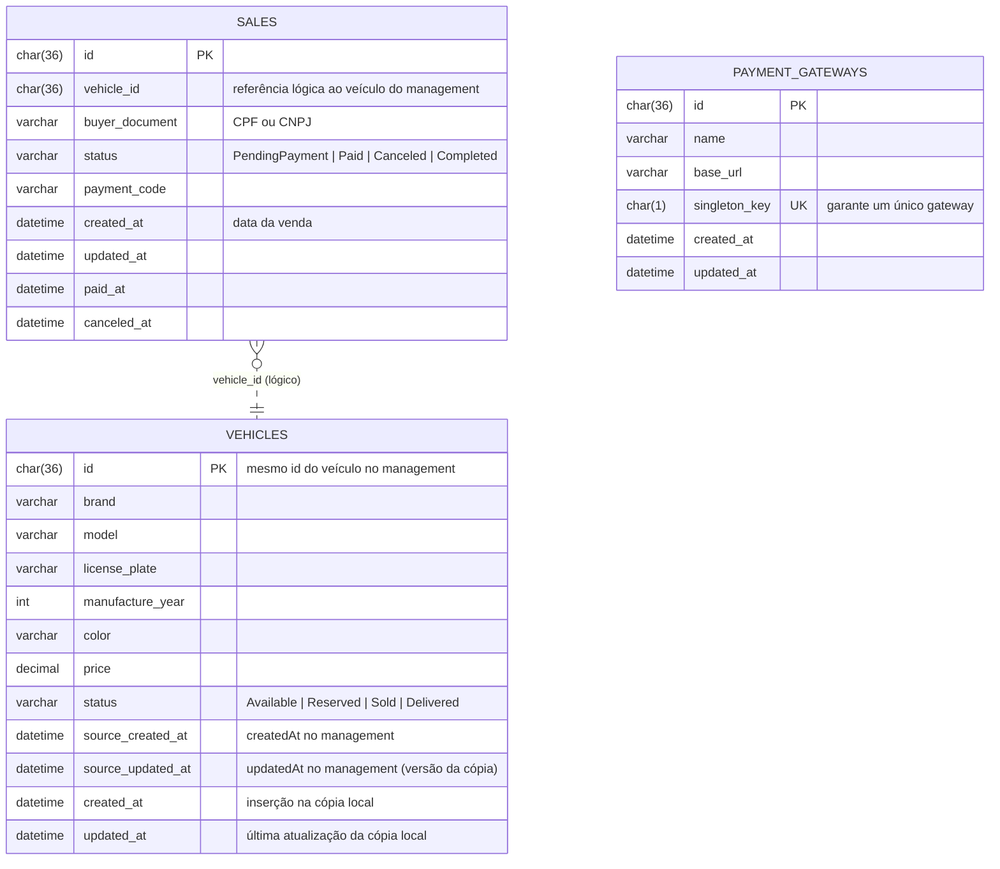
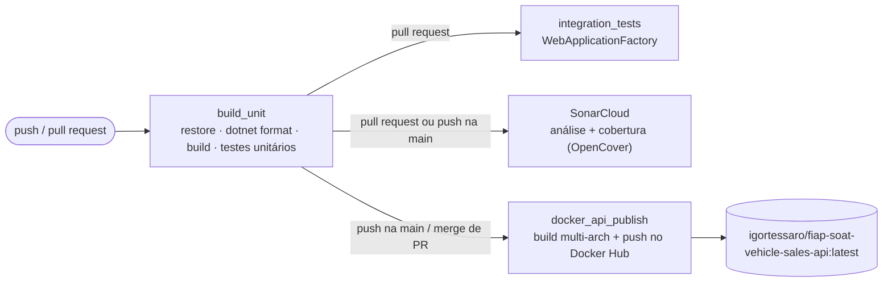

# soat-vehicle-sales

Serviço de vendas da plataforma de revenda de veículos (Tech Challenge SOAT — Fase 4).

Este serviço concentra as operações sujeitas a **picos de acesso**: as listagens de veículos à venda e vendidos, e a compra. Ele registra a venda (CPF/CNPJ do comprador e data), integra com o processador de pagamento e recebe o resultado por **webhook**. O serviço roda com um **MySQL exclusivo**, isolado do banco do serviço principal, e conversa com o [serviço de gerenciamento](https://github.com/igortessaro/soat-vehicle-management) apenas por **HTTP**.

> 📘 Visão geral da solução completa, fluxo ponta a ponta e roteiro de demonstração: [SOLUTION-OVERVIEW.md](https://github.com/igortessaro/soat-vehicle-management/blob/main/docs/SOLUTION-OVERVIEW.md)

## Sumário

- [Responsabilidades](#responsabilidades)
- [Tecnologias](#tecnologias)
- [Arquitetura](#arquitetura)
- [Fluxos](#fluxos)
- [API](#api)
- [Modelo de dados](#modelo-de-dados)
- [Como executar localmente](#como-executar-localmente)
- [Como testar](#como-testar)
- [CI/CD e qualidade](#cicd-e-qualidade)

## Responsabilidades

| Faz | Não faz |
| --- | --- |
| Listar veículos à venda e vendidos, ordenados por preço crescente | Cadastrar ou editar veículos |
| Efetuar a venda: valida o CPF/CNPJ, reserva o veículo, registra a venda e gera o código de pagamento | Alterar diretamente o estado do veículo (pede ao serviço de gerenciamento) |
| Solicitar o pagamento ao gateway cadastrado | Acessar o banco do serviço de gerenciamento |
| Receber o webhook de pagamento (`PAID` / `CANCELED`) e concluir ou cancelar a venda | |
| Registrar a entrega do veículo vendido | |
| Manter o cadastro do gateway de pagamento (um único gateway) | |

## Tecnologias

| Categoria | Tecnologia |
| --- | --- |
| Linguagem / runtime | C# · .NET 10 |
| API | ASP.NET Core Minimal APIs, OpenAPI + [Scalar](https://scalar.com/) (ambiente `Development`) |
| Casos de uso | MediatR 14 (commands/queries + handlers), FluentResults |
| Persistência | Entity Framework Core 9 + Pomelo (MySQL), MySQL 8.4 — banco **exclusivo** do serviço |
| Integrações | `IHttpClientFactory` (serviço de gerenciamento e gateway de pagamento) |
| Migrations | Flyway (scripts SQL versionados em `database/migrations`) |
| Observabilidade | Health checks (`/health`) da API e do banco |
| Containers | Docker (imagem multi-stage) e Docker Compose (ambiente completo da solução) |
| Testes | NUnit 4, Moq, Bogus, EF Core InMemory, ASP.NET Core TestHost / `WebApplicationFactory`, coverlet |
| CI/CD e qualidade | GitHub Actions, SonarCloud, Docker Hub |

## Arquitetura

O serviço segue **Clean Architecture**. As integrações externas (serviço de gerenciamento e gateway de pagamento) são portas da camada de aplicação, implementadas na infraestrutura como clientes HTTP.



```text
src/
├── Fiap.Soat.VehicleSales.Domain          # Sale, PaymentGateway, Document (CPF/CNPJ), SaleStatus
├── Fiap.Soat.VehicleSales.Application     # Casos de uso (MediatR), controllers, presenters, portas
├── Fiap.Soat.VehicleSales.Infrastructure  # EF Core, repositórios, clientes HTTP
└── Fiap.Soat.VehicleSales.Api             # Endpoints HTTP, filtros, middleware, Program
tests/
├── *.Domain.Tests · *.Application.Tests · *.Infrastructure.Tests · *.Api.Tests   # unitários
└── *.Integration.Tests                                                           # API completa em memória
database/migrations/                       # Scripts Flyway do banco de vendas
docker-compose.yml                         # Ambiente completo da solução
```

### Decisões principais

- **Banco isolado.** Vendas e gateway ficam em `fiap_soat_vehicle_sales`. O estado do veículo é sempre consultado e alterado pela API do serviço de gerenciamento, nunca direto no banco.
- **Listagens por proxy HTTP.** `GET /vehicles/available` e `/vehicles/sold` encaminham a consulta ao serviço de gerenciamento, que é a fonte única do estado do veículo. Assim não há uma cópia local para sincronizar.
- **Pagamento síncrono com webhook.** Ao criar a venda, o serviço chama o gateway. O gateway decide o resultado e chama o webhook deste serviço **antes** de responder. Por isso, a resposta do `POST /sales` já traz a venda com status final (`Paid` ou `Canceled`).
- **Gateway configurável.** A URL do processador de pagamento é cadastrada pela API (`/payment-gateways`), e o banco aceita no máximo um registro.

## Fluxos

### Compra de um veículo



### Webhook de pagamento



### Entrega e listagens



### Estados da venda



## API

Todas as rotas usam o prefixo `/api/v1`. A documentação interativa fica em `/scalar/v1` (somente em `Development`). Em caso de falha, a resposta tem o formato `{ "errors": [ { "message": "..." } ] }` e o **status HTTP do erro**.

| Método | Rota | Descrição | Principais respostas |
| --- | --- | --- | --- |
| `GET` | `/vehicles/available` | Veículos à venda, do mais barato para o mais caro | `200`, `400` |
| `GET` | `/vehicles/sold` | Veículos vendidos, do mais barato para o mais caro | `200`, `400` |
| `POST` | `/sales` | Efetua a venda (`vehicleId`, `buyerDocument`) | `200`, `400`, `502` (gateway com erro), `503` (gateway não cadastrado) |
| `PUT` | `/sales/{id}/deliver` | Registra a entrega de uma venda paga | `200`, `400` |
| `POST` | `/webhooks/payments` | Webhook do processador (`paymentCode`, `status`: `PAID`/`CANCELED`) | `200`, `404` |
| `GET` | `/payment-gateways` | Consulta o gateway cadastrado | `200`, `404` |
| `POST` | `/payment-gateways` | Cadastra o gateway (`name`, `baseUrl`) | `200`, `400`, `409` |
| `PUT` | `/payment-gateways/{id}` | Altera nome/URL do gateway | `200`, `400`, `404` |
| `GET` | `/health` (sem prefixo) | Saúde da API e do banco | `200` |

Exemplo de venda (resposta real, já com o resultado do webhook):

```bash
curl -X POST http://localhost:5002/api/v1/sales \
  -H 'Content-Type: application/json' \
  -d '{"vehicleId":"08df3385-0f21-4f14-8f13-b4680e9fefc9","buyerDocument":"529.982.247-25"}'
```

```json
{
  "isSuccess": true,
  "data": {
    "id": "08df3385-0f7a-4b7b-85f3-0a392de62b76",
    "vehicleId": "08df3385-0f21-4f14-8f13-b4680e9fefc9",
    "buyerDocument": "529.982.247-25",
    "status": "Paid",
    "paymentCode": "c5c8b2137aea474682a909de71373b20",
    "paidAt": "2026-10-26T17:17:49.348664",
    "canceledAt": null,
    "createdAt": "2026-10-26T17:17:49.320695",
    "updatedAt": "2026-10-26T17:17:49.320695"
  },
  "reasons": []
}
```

`createdAt` é a **data da venda**, `paidAt`/`canceledAt` registram o resultado do pagamento e `paymentCode` é o código que o processador usa no webhook.

## Modelo de dados



`vehicle_id` não tem chave estrangeira, porque o veículo vive em outro banco e só é acessado pela API do serviço de gerenciamento.

A tabela `vehicles` é uma **cópia somente leitura** dos veículos do management. Uma atualização só é aplicada se o `updatedAt` recebido for mais novo que o `source_updated_at` salvo, então entregas repetidas ou fora de ordem não sobrescrevem dados mais recentes. O management continua sendo a fonte da verdade: a venda sempre consulta e reserva o veículo nele.

## Como executar localmente

### Pré-requisitos

- Docker e Docker Compose
- .NET SDK 10 (apenas para rodar sem Docker ou executar os testes)
- Este repositório e o [soat-vehicle-management](https://github.com/igortessaro/soat-vehicle-management) clonados **lado a lado** no mesmo diretório, porque o Compose usa as migrations do management:

```text
workspace/
├── soat-vehicle-management/
└── soat-vehicle-sales/
```

### Ambiente completo (Docker Compose)

O `docker-compose.yml` deste repositório sobe a solução inteira:

```bash
cp .env.example .env
docker compose up -d --build
```

| Serviço | Endereço | Observação |
| --- | --- | --- |
| Sales API | <http://localhost:5002> (Scalar em `/scalar/v1`) | Construída a partir deste repositório |
| Management API | <http://localhost:5180> (Scalar em `/scalar/v1`) | Imagem `igortessaro/fiap-soat-vehicle-management-api:latest` |
| Payment Gateway (simulador) | <http://localhost:5100> | Imagem `igortessaro/fiap-soat-payment-gateway:latest` |
| MySQL de vendas | `localhost:3306` | Banco `fiap_soat_vehicle_sales` |
| MySQL do gerenciamento | `localhost:3307` | Banco `fiap_soat_vehicle_management` |

Antes da primeira venda, cadastre o gateway de pagamento (o nome do host é o do container na rede do Compose):

```bash
curl -X POST http://localhost:5002/api/v1/payment-gateways \
  -H 'Content-Type: application/json' \
  -d '{"name":"soat-payment-gateway","baseUrl":"http://payment-gateway:8080"}'
```

O roteiro completo de demonstração (seed de veículos, compra, webhook, entrega e listagens) está na [visão geral da solução](https://github.com/igortessaro/soat-vehicle-management/blob/main/docs/SOLUTION-OVERVIEW.md).

### Sem Docker

Com o MySQL de vendas e o serviço de gerenciamento acessíveis:

```bash
ConnectionStrings__MySql="server=localhost;port=3306;database=fiap_soat_vehicle_sales;user=vehicle_user;password=vehicle_pass" \
VehicleManagement__BaseUrl="http://localhost:5180/api/v1" \
  dotnet run --project src/Fiap.Soat.VehicleSales.Api
```

### Configurações

| Chave (variável de ambiente) | Padrão | Descrição |
| --- | --- | --- |
| `ConnectionStrings:MySql` (`ConnectionStrings__MySql`) | — | Banco de vendas (obrigatória) |
| `VehicleManagement:BaseUrl` (`VehicleManagement__BaseUrl`) | — | URL do serviço de gerenciamento |
| `VehicleSync:Enabled` (`VehicleSync__Enabled`) | `true` | Liga a sincronização periódica da cópia local de veículos |
| `VehicleSync:IntervalSeconds` (`VehicleSync__IntervalSeconds`) | `10` | Intervalo da sincronização; valores menores ou iguais a zero impedem a aplicação de subir |
| `Cors:AllowedOrigins` (`Cors__AllowedOrigins__0`, ...) | vazio | Origens liberadas no CORS |

A sincronização roda uma vez logo na subida e depois a cada intervalo. Se o gerenciamento estiver fora do ar, a falha é registrada em log e a próxima execução tenta de novo, sem afetar o restante da API.

## Como testar

```bash
# Todos os testes (unitários + integração)
dotnet test Fiap.Soat.VehicleSales.slnx

# Cobertura (relatório OpenCover em ./coverage)
dotnet test Fiap.Soat.VehicleSales.slnx --settings coverlet.runsettings \
  --collect:"XPlat Code Coverage" --results-directory ./coverage
```

| Projeto de testes | Escopo | Testes |
| --- | --- | --- |
| `Domain.Tests` | `Sale`, `PaymentGateway`, `Vehicle` (cópia local), validação de CPF/CNPJ (`Document`) | 36 |
| `Application.Tests` | Handlers, controllers, presenters e mappers (dependências mockadas) | 73 |
| `Infrastructure.Tests` | Repositórios (EF Core InMemory) e clientes HTTP (handler HTTP falso) | 65 |
| `Api.Tests` | Endpoints (TestHost), filtro, middleware, health check, sincronização em segundo plano | 39 |
| `Integration.Tests` | API completa via `WebApplicationFactory` + EF InMemory, com gerenciamento e gateway simulados por stub HTTP | 30 |

Os testes de integração exercitam o fluxo real da aplicação: venda, falhas de reserva e de pagamento, webhook pago/cancelado, entrega, listagens e cadastro do gateway. Os clientes HTTP reais rodam contra um stub, sem rede e sem Docker.

Cobertura no SonarCloud: **98,6%** ([painel do projeto](https://sonarcloud.io/project/overview?id=igortessaro_soat-vehicle-sales)). O mínimo exigido é 80%.

## CI/CD e qualidade

O workflow [`.github/workflows/dotnet.yml`](.github/workflows/dotnet.yml) roda em pushes e em Pull Requests para `main`/`develop`:



- **Formatação:** `dotnet format --verify-no-changes` falha o build se o código não estiver formatado.
- **Qualidade:** a análise do SonarCloud recebe a cobertura em formato OpenCover gerada pelo coverlet.
- **Deploy:** o deploy da aplicação é a **publicação da imagem no Docker Hub** (`igortessaro/fiap-soat-vehicle-sales-api:latest`). Ele roda automaticamente a cada merge de Pull Request na `main`, e qualquer ambiente com Docker passa a usar a nova versão com `docker compose pull && docker compose up -d`.
